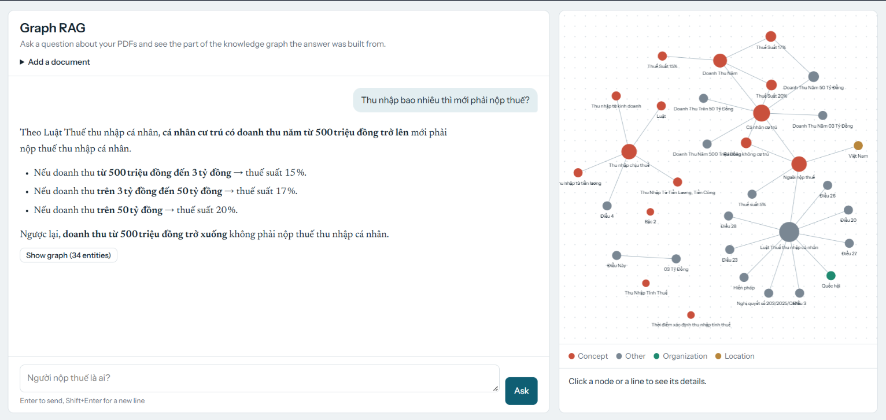
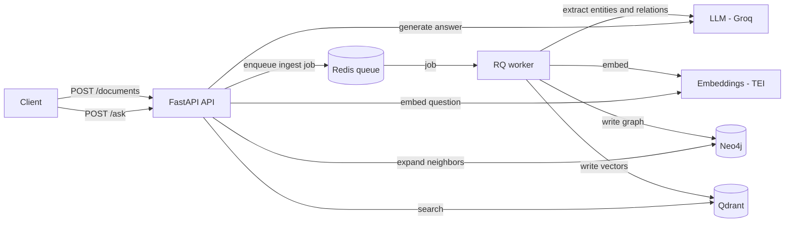

# Simple Graph RAG

A compact, production-minded implementation of **Graph RAG** (inspired by [LightRAG](https://github.com/HKUDS/LightRAG)).
Upload PDF documents, and the system builds a knowledge graph plus vector indexes from them, then answers questions using both.

The focus of this project is a **simple, readable codebase with a clean architecture**: few concepts, small modules, clear boundaries between stages.

## How it works

Plain vector RAG retrieves isolated text chunks. Graph RAG also extracts **entities and relations** from the text, so retrieval can follow connections between concepts instead of relying on text similarity alone.

- **Vector search (Qdrant)** finds the most relevant entities, relations and chunks by meaning.
- **Graph traversal (Neo4j)** expands those starting points to their neighbors, adding related context.
- **The LLM** answers using only that assembled context.

## Demo

The project ships with a small web page: ask a question, read the answer, and see the part of the knowledge graph it was built from.



## Architecture



Ingestion is slow (one LLM call per chunk), so it runs **asynchronously**: the API stores the file, enqueues a job in Redis and returns a job id immediately. A separate worker process does the heavy lifting, so jobs survive API restarts and ingestion never slows down question answering.

### Ingestion pipeline

```
PDF -> text -> chunks -> entities + relations (LLM) -> merge duplicates -> embed -> Neo4j + Qdrant
```

| Stage | Module | What it does |
|---|---|---|
| Load | `pipeline/loader.py` | Extracts text from a PDF |
| Chunk | `pipeline/chunking.py` | Sliding-window split by characters |
| Extract | `pipeline/extraction.py` | LLM returns entities and relations as JSON |
| Merge | `pipeline/merge.py` | Groups duplicates by id, summarizes long descriptions |
| Index | `pipeline/indexing.py` | Writes the graph to Neo4j and embeddings to Qdrant |

### Query pipeline

```
question -> embed -> Qdrant (entities, relations, chunks) -> Neo4j (neighbors) -> context -> LLM -> answer
```

| Stage | Module | What it does |
|---|---|---|
| Retrieve | `pipeline/retrieval.py` | Hybrid vector search and graph expansion, returns a `RetrievedContext` |
| Generate | `pipeline/generation.py` | Formats the context into a prompt and asks the LLM |

## Tech stack

| Concern | Choice | Why |
|---|---|---|
| API | FastAPI | Typed request models, automatic Swagger docs |
| Job queue | Redis + RQ | Durable jobs, API and worker decoupled, simpler than Celery |
| Graph store | Neo4j (Community) | Native graph database, neighbor lookups are one Cypher query |
| Vector store | Qdrant | Dedicated vector database, one collection per item type |
| LLM | `gpt-oss-120b` via Groq | OpenAI-compatible API, fast inference |
| Embeddings | `BAAI/bge-m3` via Text Embeddings Inference | Strong Vietnamese support, self-hosted, no rate limits |
| Packaging | Docker Compose | One command brings up the whole system |

## Design decisions

- **Four small data models** (`Chunk`, `Entity`, `Relation`, `RetrievedContext` in `models.py`) are the only things passed between stages. Stages know nothing about each other's internals.
- **Storage hides behind small classes** (`GraphStore`, `VectorStore`). Swapping Neo4j or Qdrant means changing one file.
- **Deterministic ids.** Entity ids come from the normalized name and relation ids from the sorted pair of entity ids (relations are undirected). Merging is a plain group-by-id, and re-ingesting a file never creates duplicates.
- **Ingestion accumulates across documents.** New results are merged with what is already stored instead of overwriting it.
- **JSON extraction output.** Instead of delimiter-separated tuples, the LLM returns JSON that is parsed and validated. A malformed chunk is skipped and logged, it never aborts the document.
- **On-disk LLM cache.** Every LLM response is cached by hash of model, prompt and parameters. Re-runs are fast and free, a crashed ingestion resumes where it stopped, and editing a prompt invalidates only the affected entries. Truncated responses are never cached.
- **Fresh connections per job.** The RQ worker forks for each job, so database connections are opened inside the job instead of being shared across the fork.

## Project structure

```
.
├── main.py                  # CLI: ingest / ask
├── Dockerfile
├── docker-compose.yml       # neo4j, qdrant, redis, api, worker
├── requirements.txt
└── src/
    ├── models.py            # Chunk, Entity, Relation, RetrievedContext
    ├── config.py            # Settings read from environment variables
    ├── clients.py           # llm() with disk cache, embed()
    ├── app.py               # GraphRAG facade: ingest_pdf(), ask()
    ├── api.py               # # FastAPI endpoints, serves the demo page
    ├── jobs.py              # RQ queue, job function, job status
    ├── pipeline/
    │   ├── loader.py
    │   ├── chunking.py
    │   ├── extraction.py
    │   ├── merge.py
    │   ├── indexing.py
    │   ├── retrieval.py
    │   └── generation.py
    └── storage/
        ├── graph_store.py   # Neo4j
        └── vector_store.py  # Qdrant
```

## Getting started

### Prerequisites

- Docker and Docker Compose
- A [Groq](https://console.groq.com) API key
- An embedding server (Text Embeddings Inference) listening on port 8081 of the host:

```bash
docker run -p 8081:80 -v $PWD/tei-data:/data \
  ghcr.io/huggingface/text-embeddings-inference:cpu-latest \
  --model-id BAAI/bge-m3
```

### Run

Create a `.env` file in the project root:

```
GROQ_API_KEY=your_groq_key
NEO4J_PASSWORD=choose_a_password_of_8_chars_or_more
QDRANT_API_KEY=choose_a_long_random_key
REDIS_PASSWORD=choose_a_password
# Optional: change the published API port (default 8000)
# API_PORT=8001
```

Start everything:

```bash
docker compose up -d --build
docker compose ps
```

Open the demo page at `http://localhost:8000/` (or your `API_PORT`). The interactive API docs are at `/docs`.

### Usage
The easiest way is the demo page at `/`: upload a PDF, wait until indexing finishes, then chat. The same steps are available through the API:
1. **Upload a PDF** with `POST /documents`. The response contains a `job_id`.
2. **Poll the job** with `GET /jobs/{job_id}` until `status` is `finished` (`queued` → `started` → `finished`, or `failed`).
3. **Ask a question** with `POST /ask`:

```json
{"question": "Who is a taxpayer?"}
```

Follow the worker's progress with `docker compose logs -f worker`.

### Command line (without the API)

```bash
python main.py ingest data/your_file.pdf
python main.py ask "Who is a taxpayer?"
```

## API

| Method | Path | Description |
|---|---|---|
| `GET` | `/` | Demo web page |
| `GET` | `/health` | Liveness check |
| `POST` | `/documents` | Upload a PDF, returns `202` and a `job_id` |
| `GET` | `/jobs/{job_id}` | Job status, plus result or error |
| `POST` | `/ask` | Answer a question. Also returns the `nodes` and `edges` of the graph used, ready to be drawn |
## Configuration

Settings live in `src/config.py` and are read from environment variables:

| Variable | Purpose |
|---|---|
| `GROQ_API_KEY`, `LLM_MODEL`, `LLM_BASE_URL` | LLM provider (any OpenAI-compatible API works) |
| `EMBEDDING_MODEL`, `EMBEDDING_BASE_URL` | Embedding server |
| `NEO4J_URI`, `NEO4J_USER`, `NEO4J_PASSWORD` | Neo4j connection |
| `QDRANT_URL`, `QDRANT_API_KEY` | Qdrant connection |
| `REDIS_URL` | Job queue |

Chunk size, overlap, entity types and output language are fields of `Config`.

## Limitations and future work

- PDFs must contain selectable text. Scanned documents would need an OCR step in the loader.
- Retrieval embeds the raw question. LightRAG additionally asks an LLM to extract keywords from the question first, which would be a natural quality improvement.
- Ingestion runs one document at a time (a single worker), which keeps the merge step safe but limits throughput.
- Chunk and entity quality has not been evaluated systematically. An evaluation set would be the next step before tuning.
- The API has no authentication.
- No automated tests yet. The pure functions (chunking, merging, JSON parsing) are good first candidates.